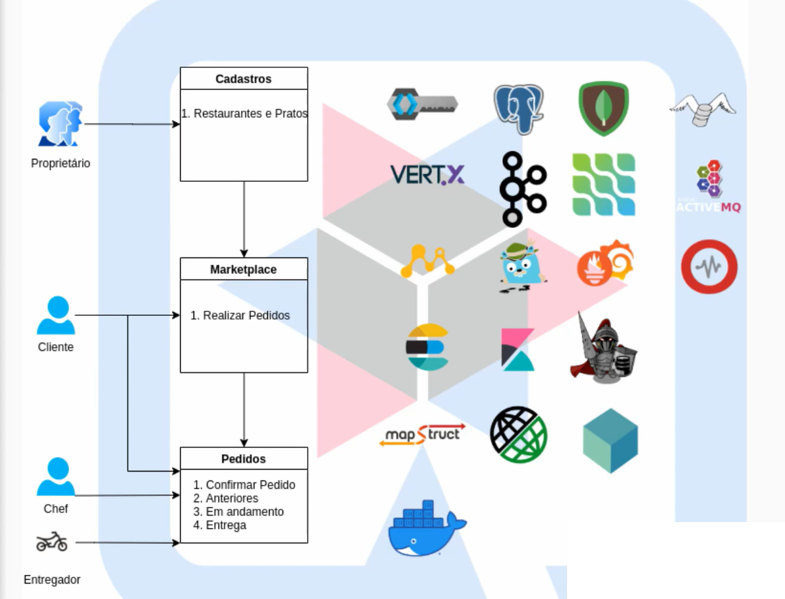

# 🚀 Desenvolvimento de Microsserviços com Quarkus

Repositório destinado aos estudos e à implementação prática dos conceitos apresentados no curso **Desenvolvimento Web com Quarkus**, com foco na construção de aplicações distribuídas, arquitetura de microsserviços, integração entre sistemas, segurança e observabilidade.

📚 **Curso:** [Desenvolvimento Web com Quarkus – Udemy](https://www.udemy.com/course/des-web-quarkus/)

## 🎯 Objetivo

Consolidar conhecimentos no desenvolvimento de aplicações Java utilizando Quarkus, explorando recursos e ferramentas do ecossistema de microsserviços.

O projeto utiliza como referência um cenário de marketplace de alimentação, envolvendo cadastro de restaurantes e pratos, realização de pedidos e integração entre diferentes serviços.

## 🏗️ Arquitetura do projeto

O cenário estudado contempla três módulos principais:

- **Cadastros:** gerenciamento de restaurantes e pratos.
- **Marketplace:** realização de pedidos pelos clientes.
- **Pedidos:** confirmação, acompanhamento, processamento e entrega dos pedidos.

Os módulos representam diferentes responsabilidades dentro de uma arquitetura distribuída, permitindo explorar comunicação, integração e organização dos microsserviços.

A imagem abaixo representa a arquitetura utilizada como referência para o desenvolvimento e estudo da aplicação.

## 🛠️ Tecnologias e ferramentas

### Linguagem e framework

### Bancos de dados e persistência

### Mensageria e comunicação

### Segurança e integração

### Observabilidade e monitoramento

### Infraestrutura e contêineres

## 📖 Conteúdos estudados

- Desenvolvimento de APIs REST com Quarkus.
- Construção e organização de microsserviços.
- Persistência de dados com PostgreSQL e MongoDB.
- Versionamento e gerenciamento de banco de dados com Flyway.
- Autenticação e autorização com Keycloak e JWT.
- Comunicação assíncrona e mensageria.
- Integração com Kafka, RabbitMQ e ActiveMQ.
- Programação reativa e ecossistema Vert.x.
- Monitoramento de aplicações com Micrometer e Prometheus.
- Construção de dashboards com Grafana.
- Rastreamento distribuído com OpenTelemetry e Jaeger.
- Containerização de aplicações com Docker.

## 📌 Objetivo final

 Aprofundar os conhecimentos em Java e Quarkus, compreendendo na prática os fundamentos de arquitetura de microsserviços e as ferramentas utilizadas no desenvolvimento de aplicações distribuídas.
